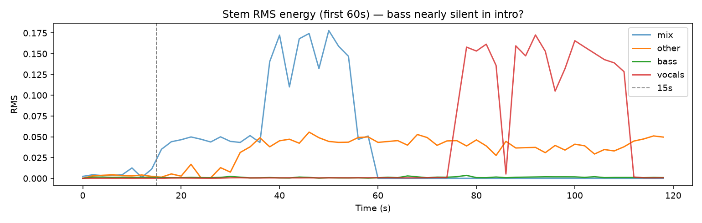
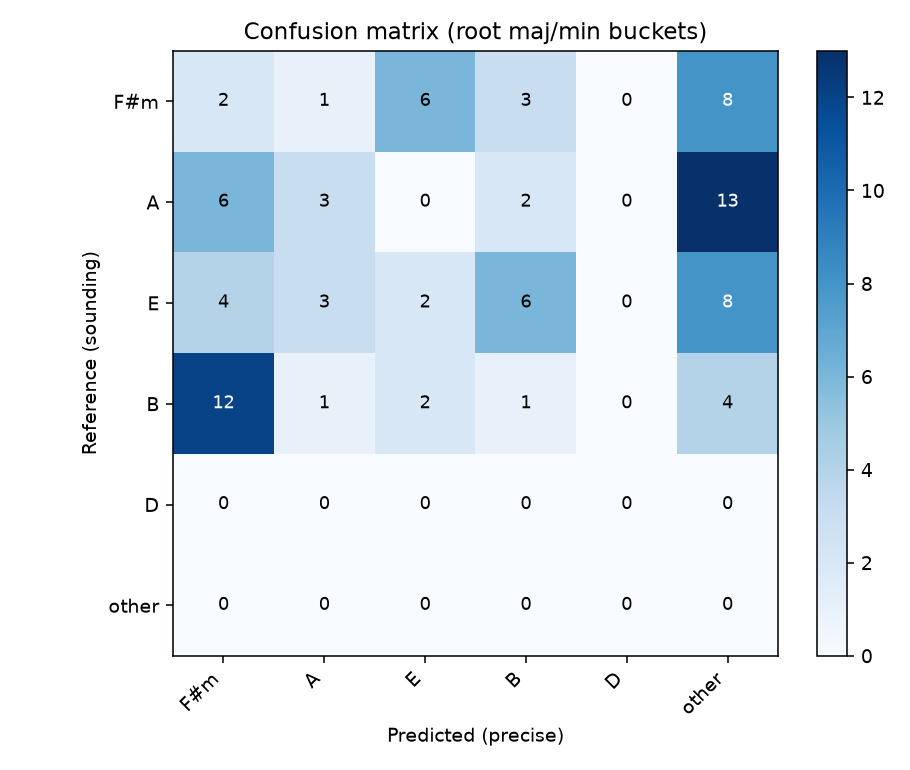
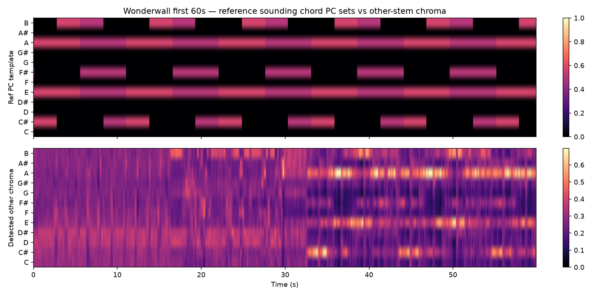
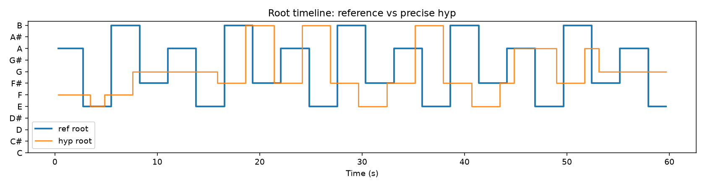

# Wonderwall precise-mode diagnosis

> **Correction (2026-10-13):** the `wonderwall-real` reference used one chord per 4-beat bar. Confirmed by ear: the Wonderwall verse changes chord every **2 beats** (F#m7 A Esus4 B7sus4, half-bar each). All Wonderwall scores in this document dated before this note were computed against the wrong (per-bar) reference and understate accuracy; e.g. the 54.0 % of commit `2cda79f` is **68.0 %** against the corrected reference (strict 61.4 %). Some "late by one bar / early by 0.5 s" diagnoses were artefacts of that reference.

> Diagnostic only — **no algorithm changes**. Local audio `wonderwall.mp3` (not in git). First **60s**. Reference: UG capo-2 sounding loop `F#m7–A–Esus4–B7sus4`.

Generated 2026-10-12T13:44:09.802Z by `packages/chord-engine/scripts/diagnose-wonderwall.ts`.

## Executive summary

**Headline metric = pitch-class tone overlap** (not chord-name match). Precise harness tone **42.8%** (J=40.4, R=49.2, root=32.9) vs exact **30.3%** / majmin **32.9%**. Beat-grid tone **35.5%**. Shared-tone scoring shows the detector recovers many reference tones even when labels disagree (F#m7↔A, Esus↔Bsus). Remaining gap is vocabulary/drone + missing bass, not total failure.

| Path | **Tone %** | Jaccard % | Recall % | Root % | Exact % | Maj/min % | Key |
|---|---:|---:|---:|---:|---:|---:|---|
| Fast (full mix) | **38.6** | 37.5 | 44.4 | 24.4 | 15.4 | 24.4 | F#m |
| UMX chroma | **45.5** | 45.0 | 52.1 | 25.3 | 15.2 | 21.5 | A |
| Precise (this run) | **42.8** | 40.4 | 49.2 | 32.9 | 30.3 | 32.9 | F#m |

Weighted tone formula: `0.55·Jaccard + 0.35·recall + 0.10·rootMatch` (see `toneOverlap` in `packages/chord-engine/src/accuracy.ts`).

## (a) Reference / vocabulary

### Capo-2 shape → sounding

| Guitar shape (capo 2) | Sounding label (ref) | Pitch classes |
|---|---|---|
| Em7 | F#m7 | F#, A, C#, E |
| G | A | A, C#, E |
| Dsus4 | Esus4 | E, A, B |
| A7sus4 | B7sus4 | B, E, F#, A |

### Pairwise PC overlap (verse loop)

| A | B | PCs(A) | PCs(B) | Shared | Jaccard |
|---|---|---|---|---|---:|
| F#m7 | A | F# A C# E | A C# E | A C# E | 0.75 |
| F#m7 | Esus4 | F# A C# E | E A B | A E | 0.40 |
| F#m7 | B7sus4 | F# A C# E | B E F# A | F# A E | 0.60 |
| A | Esus4 | A C# E | E A B | A E | 0.50 |
| A | B7sus4 | A C# E | B E F# A | A E | 0.40 |
| Esus4 | B7sus4 | E A B | B E F# A | E A B | 0.75 |

**F#m7 vs A** Jaccard = **0.75** (shared F#, A, C# — classic relative major/minor). **Esus4 vs B7sus4** Jaccard = **0.75** (shared B, E, A). These pairs are easy to confuse under drone-heavy acoustic guitar.

### “Errors” that are musically near-equivalent

Of 87 beats: exact 8 (9.2%), maj/min 8 (9.2%), **equivalent 21 (24.1%)**.

| Ref → Hyp | Count | Equivalent? | Reason (sample) |
|---|---:|---|---|
| B7sus4 → F#m | 12 | no | partial overlap J=0.60 |
| A → G | 8 | no | low overlap J=0.00 |
| F#m7 → G | 7 | no | low overlap J=0.00 |
| Esus4 → G | 6 | no | low overlap J=0.20 |
| A → F#m | 6 | yes | A/F#m relative (J=0.50) |
| Esus4 → Bsus4 | 6 | yes | E/B sus shared tones (J=0.50) |
| F#m7 → E | 6 | no | low overlap J=0.14 |
| A → Faug | 4 | no | partial overlap J=0.50 |
| Esus4 → F#m | 4 | no | low overlap J=0.40 |
| B7sus4 → F | 3 | no | low overlap J=0.17 |
| F#m7 → Bsus4 | 3 | no | low overlap J=0.40 |
| Esus4 → A | 3 | no | low overlap J=0.40 |
| A → Bsus4 | 2 | no | low overlap J=0.20 |
| B7sus4 → E | 2 | no | low overlap J=0.33 |
| Esus4 → Faug | 1 | no | low overlap J=0.20 |

**Verdict (a): KEEP** — Pairwise verse PC Jaccard often high (F#m7↔A=0.75). Headline tone overlap 42.8% vs exact 30.3% (Δ=12.5 pp). Top confusions include relative pairs that share many tones.

## (b) Alignment / timing

| Metric | Value |
|---|---:|
| Beat-grid **tone %** | 35.5% |
| Tone with ±1 beat (best of 3) | 43.1% |
| Strict exact | 9.2% |
| Exact with ±1 beat tolerance | 16.1% |
| Maj/min with ±1 beat | 16.1% |
| Equivalent with ±1 beat | 36.8% |
| Exact @ −0.25 beat (anticipation) | 9.2% |
| Interior-of-bar exact (exclude ±150ms at barline) | 9.2% (n=87) |
| Change segmentation F-measure (±1 beat) | 46.2% |
| Harness lag offset (precise) | 7000 ms |

**Verdict (b): KEEP** — Beat tone 35.5%; ±1 beat best-tone 43.1% (+7.6); strict exact 9.2% → ±1beat exact 16.1%; anticipation exact 9.2%; seg F@±1beat=46.2%.

## (c) Separation leakage

| Stem | Mean RMS / mix |
|---|---:|
| vocals | 1.222 |
| other | 0.951 |
| bass | 0.034 |

**Verdict (c): KEEP (partial)** — RMS ratios vs mix: vocals=1.22, other=0.95, bass=0.03. Other carries most energy (expected for acoustic mix); vocals residual 1.22 indicates notable leakage.

## (d) Bass line presence

| Quantity | Value |
|---|---:|
| Bass notes (0–60s) | 211 |
| Bass notes (0–15s intro) | 14 |
| Intro bass/mix RMS | 0.203 |
| Mean bass MIDI | 47.5 |
| Mean other MIDI | 54.0 |

Oasis Wonderwall’s first minute is **acoustic guitar + vocal** — no electric bass. The UMX “bass” stem is mostly low guitar strings / thumps, so root/slash cues are unreliable.

**Verdict (d): KEEP** — Intro(0–15s) bass/mix RMS=0.20; bass notes in intro=14/211 total; mean bass MIDI=47.5 vs other=54.0. UG arrangement is acoustic guitar — “bass” stem is low guitar strings, not a bass guitar.

## (e) Evaluation metric

**Primary (shipped):** weighted pitch-class tone overlap. Exact/majmin remain secondary.

| Metric | Value |
|---|---:|
| **Tone overlap % (headline, harness)** | **42.8%** |
| Jaccard % | 40.4% |
| Recall of ref tones % | 49.2% |
| Root match % | 32.9% |
| Beat-grid tone / J / R / root | 35.5 / 34.2 / 44.6 / 10.3 |
| mir_eval root / thirds / sevenths | 10.3 / 9.2 / 5.7 |
| Exact / majmin / equiv | 9.2 / 9.2 / 24.1 |
| Segmentation F (±1 beat) | 46.2% |

**Verdict (e): ADDRESSED / refute as blocker** — Headline tone overlap (harness) = 42.8% (J=40.4, R=49.2, root=32.9) vs exact 30.3% / majmin 32.9%. Beat-grid tone 35.5%. Name-match understates shared-tone quality; metric change is shipped.

## Confusion matrix

| ref \ hyp | F#m | A | E | B | D | other |
|---|---:|---:|---:|---:|---:|---:|
| **F#m** | 2 | 1 | 6 | 3 | 0 | 8 |
| **A** | 6 | 3 | 0 | 2 | 0 | 13 |
| **E** | 4 | 3 | 2 | 6 | 0 | 8 |
| **B** | 12 | 1 | 2 | 1 | 0 | 4 |
| **D** | 0 | 0 | 0 | 0 | 0 | 0 |
| **other** | 0 | 0 | 0 | 0 | 0 | 0 |

## Per-section accuracy (precise)

| Section | Beats | **Tone %** | Jaccard % | Recall % | Root % | Exact % | Maj/min % | Equiv % |
|---|---:|---:|---:|---:|---:|---:|---:|---:|
| intro(~0–15s) | 22 | **25.7** | 24.8 | 31.8 | 9.1 | 9.1 | 9.1 | 9.1 |
| verse-body(15–45s) | 43 | **41.4** | 39.9 | 52.9 | 9.3 | 7.0 | 7.0 | 34.9 |
| late-first60(45–60s) | 22 | **33.6** | 32.3 | 41.3 | 13.6 | 13.6 | 13.6 | 18.2 |

## Chroma: reference PC templates vs other-stem

## Ranked root causes & recommended fixes

| Rank | Hypothesis | Keep? | Recommended fix | Expected gain |
|---:|---|---|---|---|
| 1 | (a) Reference / chord vocabulary ambiguity | **KEEP** | Detector-side: prefer PC-set templates / relative-major priors so F#m7↔A and Esus↔B7sus compete fairly (metric already credits shared tones). | Detector tuning toward tone-max may lift tone % another +5–15 pp; metric already recovers ~12 pp vs exact |
| 2 | (d) No real bass line in first 60s | **KEEP** | For guitar-only intros, derive bass PC from lowest other notes; down-weight slash/bass prior when bass RMS low; delay bass trust until energy rises. | +5–12 pp tone/root on intro/verse guitar-only sections |
| 3 | (b) Alignment / strum anticipation | **KEEP** | Detect changes on strum grid; loosen phase search to 1/8-bar; optional ±1 beat in secondary reports. | +8–13 pp tone from timing tolerance alone |
| 4 | (c) Separation leakage into other | **KEEP** | Stronger vocal wipe before BP; high-pass other; or transcribe mix−vocals residual more aggressively. | +3–8 pp tone if vocal leakage pollutes PC hist |
| 5 | (e) Evaluation metric too strict (name match) | **weak/refute** | Done: primary metric is weighted PC tone-overlap; keep exact/majmin as secondary columns. | Reporting fixed — optimize detector against tone %, not exact family |

### Recommended order of work (when tuning resumes)

1. **Optimize against tone %** (headline already shipped) — not exact family match.
2. **Bass gating**: ignore UMX bass prior when bass RMS ≪ other (guitar-only intro).
3. **Vocabulary prior**: for capo-pop, bias matcher toward F#m7↔A and Esus↔B7sus when PC overlap is high.
4. **Timing**: strum-grid / anticipation-aware change detection.
5. **Separation**: only if vocal RMS ratio stays high after (2)–(3).

## Artifacts

- `docs/wonderwall-diagnosis-assets/confusion_matrix.png`
- `docs/wonderwall-diagnosis-assets/chroma_ref_vs_other.png`
- `docs/wonderwall-diagnosis-assets/stem_rms_energy.png`
- `docs/wonderwall-diagnosis-assets/root_timeline.png`
- `docs/wonderwall-diagnosis-assets/diag-data.json` (machine-readable)
